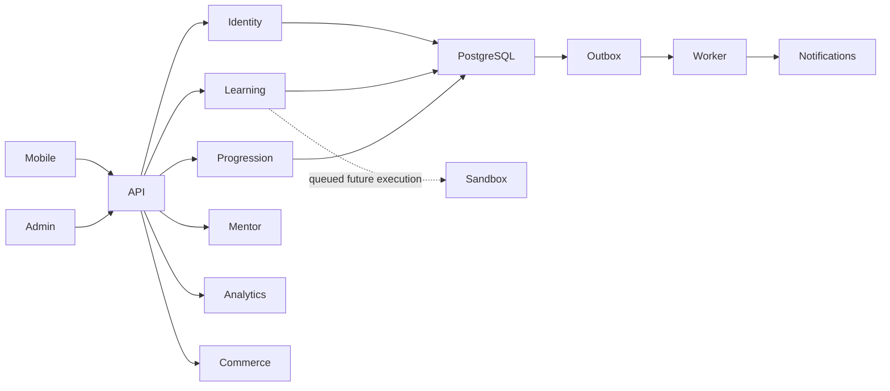

# ADR-001: Modular monolith with isolated workers

Status: accepted for foundation. One API deployment, explicit domain modules, PostgreSQL
transactions, Redis for ephemeral coordination, durable outbox before queue publishing.
Do not execute untrusted learner code in API or general worker. Sandbox service is deferred.
Alternative: microservices add operational and distributed-transaction cost before demand.
Revisit when measured workload isolation or team ownership requires separation.

